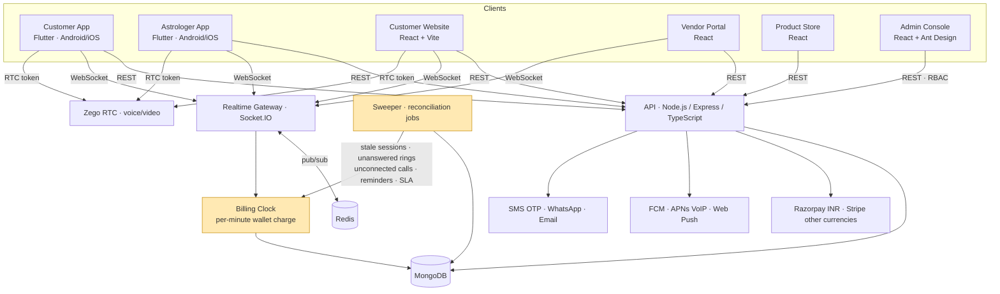

# Astrology & Wellness Consultation Marketplace

A multi-sided marketplace where customers consult astrologers live by chat, voice or video, billed per minute from a wallet. It also offers appointments, pooja bookings, a course academy with live classes, a product store and a vendor portal. The platform runs on two Flutter apps, three React web apps and one admin console that controls it all, backed by a single real-time Node.js API.

---

## Context

The client is an astrology and spiritual-wellness brand in India. It was running three separate businesses: live consultations with astrologers, astrology courses, and the sale of religious and natural products. Each had its own tools, its own customer list and its own payment flow, and the business couldn't see one customer across all three.

The hardest part was live consultations. Billing is per minute, money moves on every call, and the people on the call are on mobile phones over Indian networks. A dropped connection, an unanswered ring or an incoming regular phone call can't be allowed to cost a customer money or an astrologer earnings. Those moments are where trust, and refunds, were being lost.

## My Role

**Head of Engineering & Delivery (CTO), Vriksha Techno Solutions**

- Owned the end-to-end architecture: one API and real-time gateway serving seven client codebases.
- Designed the per-minute billing clock and the reconciliation layer that keeps wallets, sessions and astrologer status consistent when things fail mid-call.
- Led the call experience on both mobile platforms: calls that survive navigation, system picture-in-picture on Android and iOS, and hold during a regular phone call.
- Defined the release model: every push deploys to a DEV environment for client review, and production is a separate, gated release.
- Ran delivery with AI coding agents under a governance method, the same one described in [vrix-concierge-build-story](https://github.com/ksanusha84/vrix-concierge-build-story). Agents work through tests first, every client-reported fix ships with a test that reproduces it, and nothing is reported fixed until it has been verified.

## Architecture (high level)

## Tech Stack

- **Backend:** Node.js, Express, TypeScript, zod validation, Socket.IO with a Redis adapter
- **Database:** MongoDB (Mongoose), Redis (realtime fan-out, presence)
- **Mobile:** Flutter (Riverpod, go_router), plus native Kotlin (Android PiP) and Swift (iOS PiP, CallKit)
- **Web:** React, Vite, TanStack Query, Zustand; Ant Design for the admin console
- **Realtime media:** Zego Express RTC (voice and video, web and mobile)
- **Payments:** Razorpay (INR), Stripe (international currencies), in-app wallet
- **Messaging:** Firebase Cloud Messaging, APNs VoIP push, Web Push, SMS OTP, WhatsApp Business API, email
- **Documents:** PDF invoices with GST, QR verification, course certificates
- **Delivery:** GitHub Actions. Push to `main` deploys to DEV, with a schema check on every push. Production is a separately gated release.

## Key Technical Decisions

**The server owns the billing clock.**
Apps and browsers can be killed, backgrounded or lose network. They display the timer but never decide what gets charged. The server charges the wallet minute by minute, and it ends the session itself when the balance runs out.

**A reconciliation sweeper, because the realtime layer will fail.**
A crashed worker or a dropped socket can leave a session "active" forever. That keeps the astrologer marked busy, out of routing and not earning. A sweeper runs on boot and on an interval. It closes stale sessions, unanswered rings and calls one side never joined, and it drives reminders, support-ticket SLAs and post-consultation follow-ups.

**No one pays for a call that never connected.**
Ring time is configurable from admin. A call that is answered but never joined by both sides ends as *not connected* and is not billed. The website's "Connecting…" state ends on a timeout instead of hanging indefinitely.

**Calls live above navigation, not inside it.**
On mobile, the call is hosted above the app's router, so it outlives any screen. Going back shrinks it into a floating in-app window with full-screen and end-call buttons. Leaving the app hands it to the system picture-in-picture window, using a native PiP activity on Android and `AVPictureInPictureVideoCallViewController` with custom video rendering on iOS. Closing the PiP window hangs up, because a call the customer can't see must not keep billing.

**A regular phone call puts the consultation on hold.**
When the customer takes a regular phone call, the consultation goes on hold: both sides see "On hold", the timer stops and billing pauses. It resumes when the phone call ends.

**Prices are entered per currency, not converted.**
Each currency has its own entered price, so prices stay round and deliberate for every market. INR payments go through Razorpay and other currencies through Stripe, the same way on web and mobile.

**Translations are data, and admin edits always win.**
The UI catalogue (English, Tamil, Hindi) lives in the database and is edited from admin. A pipeline extracts new labels from code and imports them as insert-only. It then fills only empty translation slots, so wording edited in admin is never overwritten by a deploy. A language can also be scoped to a single page. For example, the horoscope page defaults to Tamil without switching the rest of the site.

**The business runs from admin, not from code changes.**
CMS pages, marketing landing pages for social campaigns (unlisted URLs, with each enquiry going straight into the CRM as a lead), fees, push broadcasts, KYC review and role-based staff access are all managed from the admin console.

## Scale & Outcomes

- **7 codebases** (2 mobile apps, 4 web apps including the admin console, and the API), about **400,000 lines** of TypeScript, Dart, Kotlin and Swift
- **75+ data models** across consultations, wallet, appointments, academy, e-commerce, CRM, support and content
- **110+ server test suites**, plus widget tests on the mobile call flows (PiP, hold, call window)
- One customer identity and one wallet across consultations, courses and the store
- Client feedback is turned around on a DEV environment within the review cycle, without touching production

*(Revenue, user counts and client-identifying details are confidential.)*

## What I'd Do Differently

- **Design the call host above navigation from day one.** The first version tied the call to a screen. Moving it above the router later, to support PiP and back-navigation, touched both apps.
- **Model failure states before happy paths.** States like "not connected", "on hold" and "paused" were each added after a client report. Defining them up front in the session state machine would have saved several cycles.
- **Make the translation pipeline part of CI.** New labels should be extracted and translated as part of the release itself, not as a separate step that can be left out of a release.

## Note

This is a sanitized case study of production work delivered to a private client. Source code is not included due to confidentiality. The architecture, decisions and lessons reflect my direct engineering leadership on the project.
